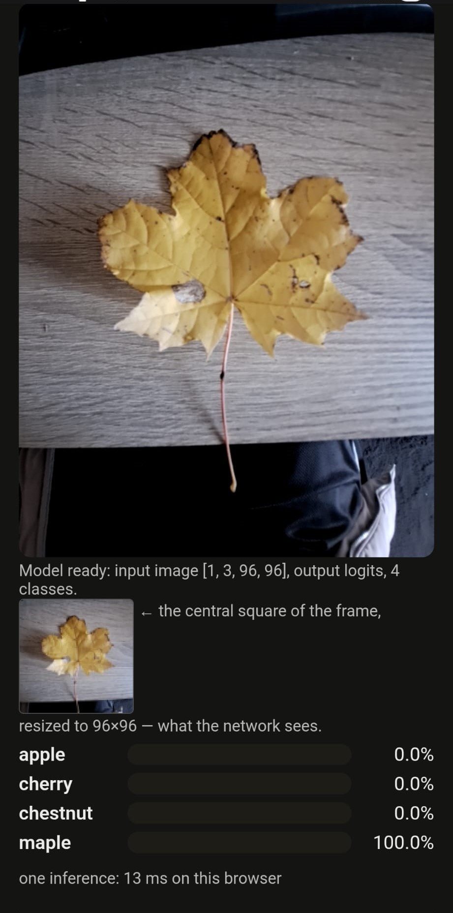

REVIEW for EXERCISE 8 

1. On-Device Model Execution:

The web app successfully runs the machine learning model directly in the mobile browser. Using WebAssembly, it correctly loads the model settings (like the 96×96 input size) and processes the live camera feed locally in real-time.

2. Exact Prediction Match:

When tested on a standard control image, the browser's predictions match the original PyTorch notebook exactly (up to six decimal places). However, because this test image is already the correct size, this check only validates the math, not the image resizing step.

3. Preprocessing Consistency:

The JavaScript code faithfully recreates the PyTorch data preparation pipeline. It correctly handles center cropping, scaling pixel values, applying statistical normalization (mean and standard deviation), and calculating the final probabilities. The only minor difference is the image resizing method: the browser uses a slightly different algorithm than PyTorch, which might cause tiny variations on live camera frames.

4. Complete Data Privacy:

A network check proves that no images are ever uploaded to a server. The application only downloads the model weights and necessary code files. Because there are no upload requests, all classification happens strictly on the user's device.

5. Real-World Limitations:

Live testing reveals a data mismatch between training and real life: leaves in the live camera feed look much smaller and have messier backgrounds compared to the clean training dataset. The model also suffers from overconfidence, predicting 100% certainty even on difficult images. Upgrading to the improved Task 4 model weights would help it perform better in real-world conditions.
